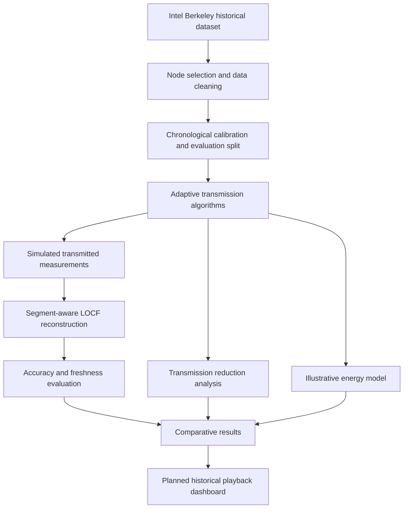

Adaptive IoT --- Energy-Aware Adaptive Sensor Network
An experimental IoT sensor-network framework that reduces communication
overhead through adaptive sampling while balancing measurement
reconstruction accuracy and data freshness.
Current implementation status: Offline simulation and evaluation
using historical measurements from the Intel Berkeley Research Lab
wireless sensor network dataset. The interactive dashboard and
historical playback interface are planned next. This is not a live
physical sensor deployment.

1. Project overview
Wireless sensor nodes often transmit measurements at fixed intervals,
even when environmental conditions are stable. This can create
unnecessary communication overhead.

This project evaluates five transmission strategies:
1. Fixed --- transmit at a fixed 60-second interval.
2. Rate --- adapt the transmission interval according to observed
   rates of change.
3. Threshold --- transmit when a sensor value changes beyond a
   calibrated threshold.
4. Threshold-H120 --- threshold-triggered transmission with a
   120-second maximum heartbeat interval.
5. Threshold-H180 --- threshold-triggered transmission with a
   180-second maximum heartbeat interval.
The aim is to reduce transmissions without allowing reconstructed sensor
values to become excessively stale.
2. Dataset
The evaluation uses the Intel Berkeley Research Lab wireless sensor
network dataset, collected from a physical deployment in 2004.
- Source: Intel Berkeley Research Lab sensor
  dataset
- Original data file:
  data.txt.gz
- Selected nodes: 22, 31, 45, 47, 48
- Selected common period: 2004-02-28 01:06:46 to
  2004-03-24 05:57:47
- Selected records: 272,278
- Evaluation records: 210,598
- Eligible environmental observations: 209,275
The dataset contains historical temperature, humidity, light and voltage
measurements. The dashboard, when implemented, will replay these
historical observations. It must not be described as live sensing.
Data preparation
- The selected five nodes were restricted to a common observation
  period.
- Raw data was retained separately from cleaned data.
- Provisional plausibility checks were applied to temperature,
  humidity, light and voltage.
- Invalid environmental observations were excluded from algorithm
  evaluation, while the original records and validity flags were
  retained.
- A chronological calibration/evaluation split was used:
  - Calibration period ended at 2004-03-04 02:04:58.
  - Remaining observations were used for evaluation.
- A source-data gap greater than 300 seconds starts a new segment.
  Each segment requires a fresh initial transmission, preventing stale
  values from being carried across long source outages.
The 300-second segmentation threshold is an operational analysis choice,
not a claim about the original network's formal outage definition.
3. System workflow

4. Experimental results
All results below are from the Intel dataset evaluation period. The
transmission reduction denominator is the 209,275 eligible
environmental observations.

  Algorithm          Transmissions   Transmission reduction
  Fixed                     89,935                   57.03%
Rate                      75,807                   63.78%
Threshold                 41,750                   80.05%
Threshold-H120            70,016                   66.54%
Threshold-H180            58,327                   72.13%
Reconstruction accuracy
Values are mean absolute error (MAE) and root mean squared error (RMSE),
calculated by comparing segment-aware reconstructed values with the
original eligible observations.

  Algorithm          Temperature MAE   Humidity MAE     Light MAE
  Fixed                      0.01549        0.03724       3.26429
Rate                       0.01460        0.03729       2.13223
Threshold                  0.02441        0.05488       1.95698
Threshold-H120         0.01180    0.03293   0.94211
Threshold-H180             0.01424        0.03782       1.17040

Sensor units follow the source dataset. The temperature and humidity
errors are in the dataset's recorded units; light error is in the
dataset's light measurement units.
Data freshness
Freshness age is the elapsed time between an original observation and
the most recent prior transmitted measurement for that node and segment.

  Algorithm          Mean age (s)   95th percentile age (s)   Maximum age (s)
  Fixed                     21.95                     59.12                60
Rate                      31.97                     86.97                90
Threshold                293.41                  1,111.78          6,544.97
Threshold-H120            42.52                    114.97               120
Threshold-H180            63.36                    166.80               180
Illustrative energy model
The model uses the following assumed costs:
- Sensing: 0.5 mJ per eligible observation
- Processing: 0.2 mJ per eligible observation
- Transmission: 50 mJ per transmitted packet
  Algorithm          Estimated total energy (J)   Savings vs Fixed
  Fixed                               4,643.242              0.00%
Rate                                3,936.842             15.21%
Threshold                           2,233.992             51.89%
Threshold-H120                      3,647.292             21.45%
Threshold-H180                      3,062.842             34.04%

Energy values are model-based estimates, not measured hardware
energy. The current model does not include radio reception, idle
listening, sleep states, retransmissions, protocol overhead or
device-specific power characteristics. The assumed battery capacity is
not used to claim a measured or validated battery lifetime.
5. Current design choice
Threshold-H120 is the current preferred candidate for the evaluated
dataset.

It achieved:
- 66.54% fewer transmissions than the eligible observation count.
- Lowest MAE among the five tested algorithms for temperature,
  humidity and light.
- A maximum reconstruction freshness age of approximately 120 seconds
  within each source-data segment.
- 21.45% lower estimated energy than the fixed strategy under the
  stated illustrative model.
This is a dataset-specific experimental result, not proof that H120 is
universally optimal. Threshold-only gives the greatest transmission and
modelled energy reduction, but its freshness is substantially worse.
H180 offers a more communication-efficient alternative with a longer
maximum freshness age.
6. Important limitations
1. Historical data: measurements are from a 2004 physical
   deployment. Playback is historical replay, not real-time sensing.
2. Simulated transmission decisions: the source dataset does not
   provide the packet transmission log needed to validate these
   simulated decisions against actual network transmissions.
3. Estimated energy: energy consumption is calculated from explicit
   assumptions, not measured from ESP32 or original sensor hardware.
4. No event ground truth: the dataset does not provide reliable
   event labels. This project does not claim validated event-detection
   accuracy.
5. Source outages: long gaps in the original dataset are segmented
   so reconstruction does not carry stale values across them.
6. Dataset-specific calibration: thresholds are calibrated on an
   earlier chronological period and evaluated on later observations.
   Performance may differ on other deployments or environmental
   conditions.
7. Repository structure
Energy-Aware-Adaptive-IoT/
├── README.md
├── requirements.txt
├── notebooks/
│   └── energy_aware_simulation.ipynb
├── datasets/
├── src/
├── results/
│   ├── csv/
│   └── graphs/
└── docs/
    ├── architecture/
    └── report/
Large raw datasets and bulky reconstruction exports are maintained in
Google Drive rather than committed to GitHub. The repository should
contain source code, notebook, lightweight result summaries,
configuration and documentation.
8. Running the experiments
The current experiment notebook is designed for Google Colab.
1. Open notebooks/energy_aware_simulation.ipynb in Google Colab.
2. Download the Intel dataset from the official source linked above.
3. Follow the notebook cells in order to prepare the dataset, calibrate
   the algorithms, run the simulations and generate evaluation tables.
4. Keep the calibration period chronological and separate from the
   evaluation period.
5. Review the assumptions and limitations before interpreting the
   energy results.
Python packages used include:
- Python 3
- pandas
- NumPy
- Matplotlib
A requirements.txt file will be maintained as the project environment
is finalized.
9. Roadmap
- [x] Acquire and inspect the Intel Berkeley sensor dataset.
- [x] Select five nodes and prepare a common evaluation period.
- [x] Implement fixed, rate-based and threshold-based transmission
  strategies.
- [x] Add heartbeat variants with 120-second and 180-second limits.
- [x] Implement source-outage-aware segmentation and reconstruction.
- [x] Evaluate transmission reduction, reconstruction accuracy and
  freshness.
- [x] Implement an explicitly assumption-based energy comparison.
- [ ] Build an interactive monitoring dashboard.
- [ ] Integrate historical dataset playback controls.
- [ ] Test dashboard metrics against exported experiment results.
- [ ] Complete final project report, architecture diagrams and
  presentation.
- [ ] Consider physical ESP32 validation as a separate extension.
10. Project status
The algorithm simulation and offline evaluation are complete. The
interactive dashboard, playback integration, final report and
presentation remain in progress.

The project is an experimental software evaluation of energy-aware
adaptive sampling. Claims about real hardware energy savings or live
sensor operation require additional physical validation.
